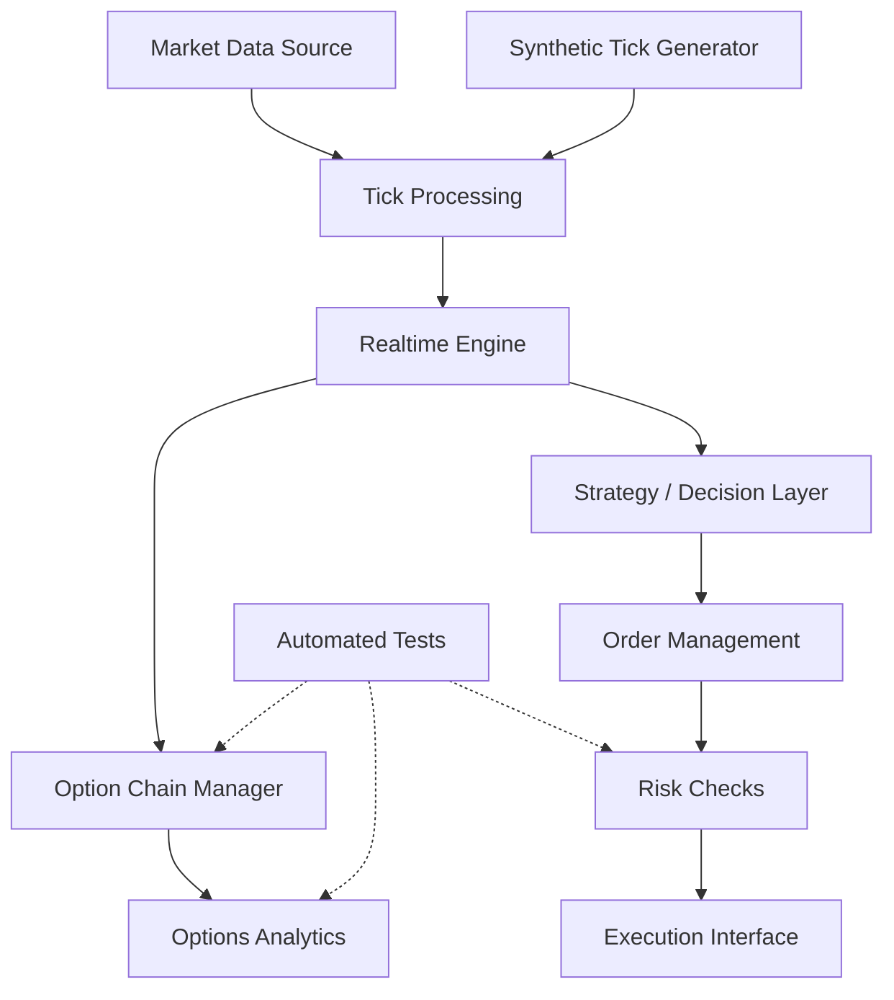

# 🚀 TradeAuraGate

### Modern C++20 Trading Engine & Offline Options Simulator

<p align="center">
  
  
  
  
  
</p>

**TradeAuraGate** is a C++20 trading-engine project focused on real-time market-data processing, options analytics, risk-aware order-management components, and offline simulation.

The project provides a development environment for exploring trading-system architecture without requiring broker credentials or a live trading account.

> [!IMPORTANT]
> **Offline mode uses simulated market data.** It does not establish a broker connection, represent live exchange prices, or place real orders.

---

## 📚 Table of Contents

- [✨ Features](#-features)
- [🏗️ Architecture](#️-architecture)
- [🧮 Options Analytics](#-options-analytics)
- [🛡️ Risk Management](#️-risk-management)
- [⚙️ Requirements](#️-requirements)
- [🚀 Build and Run](#-build-and-run)
- [🧪 Run Tests](#-run-tests)
- [📂 Project Structure](#-project-structure)
- [📊 Performance Engineering](#-performance-engineering)
- [🗺️ Roadmap](#️-roadmap)
- [🔐 Security](#-security)
- [⚠️ Disclaimer](#️-disclaimer)
- [👨‍💻 Author](#-author)

---

## ✨ Features

| Component | Description |
|---|---|
| ⚡ C++20 Engine | Modern C++ implementation organized into reusable components |
| 📡 Market Data | Tick-processing interfaces and WebSocket integration components |
| 🧪 Offline Simulator | Inject synthetic ticks without connecting to a broker |
| 📈 Options Analytics | Black–Scholes pricing and Greek calculations |
| 🎯 Implied Volatility | Implied-volatility calculation utilities |
| 🔄 Option Chain | Register option instruments and display simulated chain data |
| 🛡️ Risk Components | Order-management and risk-related modules |
| 🧰 CMake Build | Reproducible project configuration and compilation |
| ✅ Automated Tests | CTest-based test execution |

*Feature availability depends on the implementation in the current branch. Performance and numerical accuracy should be established through dedicated tests and benchmarks.*

## 🏗️ Architecture



### Main processing flow

1. **Market-data input:** Receive ticks from a configured data source or generate synthetic ticks in offline mode.
2. **Tick processing:** Parse and route incoming market updates.
3. **Option-chain management:** Maintain the registered option instruments and their available market values.
4. **Analytics:** Calculate option prices and Greeks using the implemented pricing functions.
5. **Decision and risk components:** Connect strategy logic to order-management and risk checks as these modules are implemented and tested.
6. **Validation:** Use automated tests and reproducible simulations to verify behavior.

---

## 🧮 Options Analytics

TradeAuraGate includes Black–Scholes-related functionality in its Greek analytics module.

Potential calculations include:

- **Delta (Δ):** Sensitivity of option value to the underlying price.
- **Gamma (Γ):** Sensitivity of Delta to the underlying price.
- **Theta (Θ):** Sensitivity to the passage of time.
- **Vega (ν):** Sensitivity to volatility.
- **Rho (ρ):** Sensitivity to the risk-free interest rate.
- **Implied Volatility (IV):** Volatility estimated from an observed option premium.

### Example output

```text
========================================================
       TradeAuraGate - OFFLINE OPTIONS SIMULATOR
========================================================
Mode: SIMULATED DATA ONLY
Underlying: 25000.00

Strike    Call Premium    Put Premium    Analytics
--------------------------------------------------------
24900     Simulated       Simulated      Greeks / IV
24950     Simulated       Simulated      Greeks / IV
25000     Simulated       Simulated      Greeks / IV
25050     Simulated       Simulated      Greeks / IV
25100     Simulated       Simulated      Greeks / IV
--------------------------------------------------------
No live market data or real orders in offline mode.
```

*Illustrative format only; values depend on the simulator's current configuration.*

### Numerical validation checklist

- [ ] Verify Black–Scholes prices against known reference cases.
- [ ] Test call and put Delta, Gamma, Vega, Theta, and Rho.
- [ ] Validate implied-volatility round trips against known premiums.
- [ ] Reject invalid inputs and premiums outside valid pricing bounds.
- [ ] Confirm volatility units and Theta time units are consistent.

---

## 🛡️ Risk Management

Risk controls are essential in any trading system. The project includes order-management and risk-related components that can be extended and validated for:

- Order quantity and notional limits.
- Position and exposure limits.
- Invalid order rejection.
- Duplicate-order protection.
- Order-state tracking.
- Failure handling and structured logging.

**Important:** These are design and validation objectives, not a claim that every control is currently implemented or production-ready. Verify each control in the corresponding source code and tests before using the engine for real execution.

---

## ⚙️ Requirements

Install the following tools in your development environment:

- A C++20-compatible compiler, such as GCC or Clang.
- CMake.
- GNU Make or another supported build tool.
- Git.

On Ubuntu or a GitHub Codespaces Linux environment:

```bash
sudo apt-get update
sudo apt-get install -y build-essential cmake git
```

Check the installed tools:

```bash
g++ --version
cmake --version
git --version
```

---

## 🚀 Build and Run

### 1. Clone the repository

```bash
git clone https://github.com/RoyalTejShinde1993/TradeAuraGate.git
cd TradeAuraGate
```

### 2. Configure the project

```bash
cmake -S . -B build
```

### 3. Build

```bash
cmake --build build --parallel 2
```

### 4. Run the offline simulation

```bash
./build/nexus_engine --offline
```

The offline simulator injects synthetic ticks into the engine and displays the resulting option-chain information. No broker credentials are required for this mode.

---

## 🧪 Run Tests

Run the test suite with:

```bash
ctest --test-dir build --output-on-failure
```

To list the available CTest tests:

```bash
ctest --test-dir build -N
```

For more detailed test output:

```bash
ctest --test-dir build --verbose
```

A successful test run confirms that the configured tests passed; it does not independently establish production readiness, live-market reliability, or numerical accuracy beyond the tested cases.

---

## 📂 Project Structure

```text
TradeAuraGate/
├── CMakeLists.txt
├── README.md
├── examples/
│   └── main.cpp
├── include/
│   ├── engine/
│   │   └── RealtimeEngine.hpp
│   ├── greek/
│   │   └── Greek.hpp
│   └── shoonyacpp/
│       └── api.hpp
├── src/
│   └── engine/
│       └── RealtimeEngine.cpp
├── tests/
└── build/
```

*This is a high-level illustration, not a complete file inventory. Check the repository for the exact current directory structure. The `build/` directory is generated by CMake and generally should not be committed.*

---

## 📊 Performance Engineering

Trading systems often require predictable latency, bounded resource use, and reliable recovery from failures.

Areas to investigate and measure in TradeAuraGate include:

- Tick-processing throughput.
- Allocation behavior during market-data updates.
- Lock contention and thread coordination.
- Option-chain update cost.
- Greek calculation throughput.
- Risk-check and order-management overhead.
- Tail latency under sustained load.
- CPU and memory usage during long-running simulations.

### Benchmarking principles

1. Define the workload and test environment.
2. Warm up the program before collecting measurements.
3. Run multiple iterations and report median and tail latency.
4. Separate parsing, analytics, risk checks, and execution measurements.
5. Document compiler flags, hardware, data volume, and methodology.

Avoid publishing microsecond or millisecond performance claims until they have been measured reproducibly.

---

## 🗺️ Roadmap

- [x] CMake-based build configuration
- [x] Offline simulation entry point
- [x] Synthetic tick injection
- [x] Option-chain simulation
- [x] Initial automated test suite
- [ ] Expand Black–Scholes and implied-volatility unit tests
- [ ] Add reproducible performance benchmarks
- [ ] Add structured logging and error-reporting tests
- [ ] Extend risk-control and order-state tests
- [ ] Improve documentation for each public API
- [ ] Validate live connectivity separately from offline simulation

Roadmap items should be updated as functionality is implemented, tested, and merged.

---

## 🔐 Security

- Never commit broker passwords, API secrets, access tokens, or session credentials.
- Use environment variables or a suitable secret-management system for sensitive configuration.
- Keep offline simulation separate from real execution.
- Validate market-data and order inputs.
- Test failure scenarios before connecting to any live account.
- Review risk controls and broker-specific requirements before enabling order placement.

---

## ⚠️ Disclaimer

TradeAuraGate is a software-development and educational project. Offline output is synthetic and is not financial advice or a representation of real market conditions.

Trading and derivatives involve substantial financial risk. Do not use the project for live trading without appropriate testing, independent validation, security review, operational monitoring, and risk controls.

---

## 👨‍💻 Author

**Tejas Shinde**

- GitHub: [@RoyalTejShinde1993](https://github.com/RoyalTejShinde1993)
- Repository: [TradeAuraGate](https://github.com/RoyalTejShinde1993/TradeAuraGate)

---

<p align="center">
  <strong>Built with C++20, tested through simulation, and designed for continued engineering improvement.</strong>
</p>
